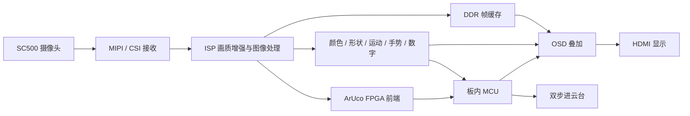

# 基于安路 PH1P35 的实时图像处理与视觉交互系统

本作品面向 FPGA 图像处理赛题，基于 **PH1P35MDG324 + SC500 摄像头**构建集图像采集、画质增强、多模式视觉处理、目标识别和云台跟踪于一体的嵌入式视觉系统。系统以 **1280×720** 视频为输入，通过 FPGA 流水线并行处理、DDR 帧缓存和 HDMI 实时输出，将视觉分析结果直接叠加到画面中，并通过板内 MCU 实现 ArUco 处理及双步进云台控制。

## 作品特色

- **实时视频与画质增强**：MIPI/CSI 视频接入，自动白平衡、自动曝光与亮度增益、5×5 降噪，适应不同光照场景。
- **七种图像模式**：直通、灰度、Sobel 边缘、二值、素描、浮雕和卡通化，可通过按键切换。
- **颜色与几何形状识别**：提取红、绿、蓝目标，识别圆形、三角形、矩形和长条形，实时叠加位置框及类别。
- **运动区域提示与计数**：结合帧间变化和网格统计，显示运动区域与运动统计信息。
- **手势与数字交互**：纯 FPGA 张掌/握拳识别，以及任意位置单张数字卡 0～9 的定位与识别。
- **ArUco 标记识别**：FPGA 与 MCU 协作完成标记识别、ID 显示、四边形描边和三维坐标轴可视化。
- **双步进云台跟踪**：视觉目标坐标传给 MCU，驱动双轴步进云台跟踪红色球形物体。
- **一体化 OSD**：叠加 Logo、模式、帧计数、延迟、IN/OUT 帧率及检测状态，方便现场操作与演示。

## 系统架构



## 板上操作

| 控制 | 功能 |
| --- | --- |
| KEY1 | 循环切换七种图像模式 |
| KEY2 | 开启或关闭双步进云台跟踪 |
| KEY3 | 开启或关闭自动白平衡 |
| KEY4 | 开启或关闭自动曝光与亮度增益 |
| SW1 | 颜色、形状与运动检测 |
| SW2 | ArUco 标记检测 |
| SW3 | 张掌 / 握拳手势识别 |
| SW4 | 单张数字卡识别 |

数码管显示整体增益 index 及使能状态。电机上电默认关闭，通过 KEY2 或串口命令开启。

FPS 行同时显示 `IN / OUT` 帧率与 `C / H / D / A / M` 状态，分别对应颜色形状、手势、数字、ArUco 和运动。`0` 为关闭，`?` 为等待结果，`-` 为无目标，`V` 为有效结果，`S` 为停更提示；后面的数字表示活动年龄，`3` 表示 3 秒或以上。该信息直接加入现有 FPS 行，七种图像模式保持独立。

## 当前交付

**FPGA v101r1 + MCU v95 联合 Flash**，支持掉电保存。2026-10-26 已通过官方 BitWriter 终端写入与校验。

| 项目 | 实现结果 |
| --- | --- |
| Slice | **19910 / 21216** |
| ERAM | **108 / 108** |
| DSP | **31 / 40** |
| 最终时序 | **Routed** |
| Setup / Hold 最差裕量 | **+0.122 ns / +0.020 ns** |
| Setup / Hold 总负裕量 | **0 / 0** |

当前固件位于 [`firmware/`](firmware/)，资源与时序报告位于 [`verification/`](verification/)。

## 工程目录

| 目录 | 内容 |
| --- | --- |
| `contest2_hdmi_video/rtl/` | FPGA 维护源码、IP 和 ROM 资源 |
| `contest2_hdmi_video/prj/` | TD 工程、引脚与时序约束 |
| `contest2_hdmi_video/host/tests/` | RTL 与算法测试 |
| `mcu_tracking/` | ArUco、步进控制与串口工具 |
| `vendor/anlogic_sdk/` | MCU 构建依赖及许可声明 |
| `tools/` | 工程校验、构建、封装与终端烧录入口 |
| `firmware/` | 当前 FPGA、MCU 和联合 Flash 固件 |
| `verification/` | 资源、时序与版本信息 |
| `docs/`、`examples/` | 技术文档、演示材料与测试卡 |

## 构建与部署

环境：Windows、Python 3.11+、TD 6.2.1 Engineer、FD Release 2026.2；RTL 仿真使用 Icarus Verilog。

复制 `config.example.json` 为 `config.local.json`，填写 TD、FD 安装目录和 MCU 编译暂存目录。也可通过 `ANLOGIC_TD_HOME`、`ANLOGIC_FD_HOME` 设置工具路径。

```powershell
python -m pip install -r requirements.txt
python tools/repository.py setup
python tools/repository.py verify
python tools/repository.py test
python tools/repository.py mcu
python tools/repository.py fpga
python tools/repository.py flash-image
```

烧录当前交付固件时，连接开发板电源和 AL-LINK-FT，启动本地官方调试服务 `127.0.0.1:5555` 后执行：

```powershell
python tools/repository.py program
```

构建输出写入 `build/` 和子工程的 `tmp/`、`deliverables/`。`firmware/` 保存本次交付镜像，文件校验信息见 `PACKAGE_MANIFEST.json`。

## 文档与演示

- [FPS 同行诊断设计](docs/fpga_history/DIAGNOSTICS_FPS_V101_20261026.md)
- [旋转长条形识别设计](docs/fpga_history/BAR_ROTATION_V100_20261026.md)
- [双步进专用引脚与接线](docs/fpga_history/STEPPER_DEDICATED_PINS_20261022.md)
- [KEY2 云台控制](docs/fpga_history/KEY2_STEPPER_V83_20261022.md)
- [第三方代码与许可声明](THIRD_PARTY_NOTICES.md)

作品通过 FPGA 的流式并行处理与 MCU 的控制能力协同，实现从视频采集、视觉分析到运动控制的完整链路，便于比赛现场演示与进一步拓展。
