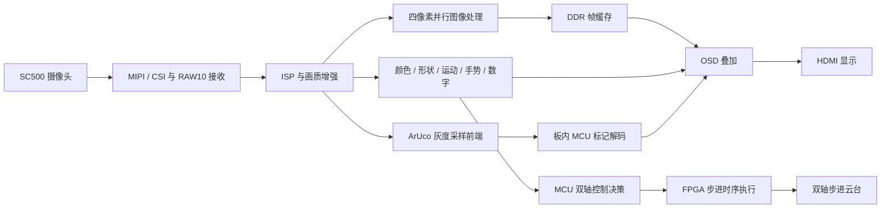

# 基于安路 PH1P35 的实时图像处理与视觉交互系统

**赛题二 · FPGA 图像处理比赛提交工程**

**四像素并行处理 · 多任务视觉感知 · FPGA–MCU 协同控制**

本作品基于 **安路 PH1P35MDG324、SC500 摄像头与双轴步进云台**，实现从图像采集、画质增强、目标识别到显示与运动控制的完整视觉链路。系统以 **1280×720** 视频为输入，在 FPGA 内完成像素流处理和多类视觉特征提取，由板内 MCU 承担 ArUco 解码及云台控制决策，通过 HDMI 同屏呈现图像、识别结果与运行状态。

设计的核心是将持续运行的视频流水线、按帧更新的视觉分析与事件驱动的控制任务组织在同一片 FPGA SoC 中。通过存储结构重构、算术单元复用和定点位宽优化，在有限片上资源内集成七种图像模式、颜色形状识别、运动检测、手势交互、数字识别、ArUco 标记识别及目标跟踪。

## 主要创新

### 四像素并行的多任务视觉流水线

以 **96 bit RGB888、每拍四像素**为视频数据通路，将 ISP、图像模式处理与视觉检测连接为连续流水线。像素数据与行帧标志同步传递，模式在帧边界提交；DDR 帧缓存完成采集与显示节拍衔接，识别结果由 OSD 统一叠加。画质处理、视觉分析和实时显示在同一视频链路内协同运行。

### 面向器件结构的资源优化

围绕“计算发生的频率、数据保存的时间、存储端口的使用方式”重新组织硬件：将帧级运算从逐像素通路中分离，通过共享迭代运算器、同步 ERAM、有限行历史和紧凑查找表降低逻辑开销。优化同时覆盖像素流水线、目标描述符、手势工作区、字形模板与 MCU 图像缓冲，形成贯穿软硬件的数据与存储设计。

### 感知、显示与执行一体化

FPGA 完成视频处理、视觉特征提取和步进脉冲执行，MCU 完成标记解码与双轴控制请求计算。视觉目标坐标进入控制链路，识别框、类别、标记 ID 与方向轴返回显示链路，在同一平台上完成“看见目标—理解目标—跟随目标”的闭环。

## 功能展示

| 功能 | 实现与画面呈现 |
| --- | --- |
| 图像采集与增强 | MIPI/CSI 视频输入，自动白平衡、自动曝光与亮度增益、5×5 邻域降噪 |
| 七种图像模式 | 直通、灰度、Sobel 边缘、二值化、素描、浮雕、卡通化，按键切换 |
| 颜色与形状识别 | 红、绿、蓝目标提取，圆形、三角形、矩形与长条形分类，叠加类别与位置框 |
| 运动检测 | 帧间变化与网格统计，显示运动区域及计数信息 |
| 手势交互 | 纯 FPGA 张掌、握拳识别，结合几何特征与时域投票发布结果 |
| 数字识别 | 单张 0～9 数字卡定位、5×7 特征提取、模板匹配及结果叠加 |
| ArUco 标记识别 | FPGA 图像前端与 MCU 协作，显示标记 ID、四边形轮廓及三维方向轴预览 |
| 双轴目标跟踪 | 根据红色球形目标位置计算控制请求，由 FPGA 执行 STEP/DIR 时序 |
| 运行状态显示 | Logo、MODE、帧计数、D 延迟指标、IN/OUT 帧率及识别结果同屏显示 |

## 系统架构



视频主链路负责持续输出图像；检测旁路生成位置、类别和几何描述符，按帧发布结果。ArUco 前端提供 **160×90** 灰度采样图，MCU 完成阈值分割、候选四边形提取与字典解码。云台控制由 MCU 计算请求、FPGA 执行脉冲，使软件决策与硬件时序各自承担适合的任务。

## 资源优化实现

| 优化对象 | 工程实现 | 结果 |
| --- | --- | --- |
| 自动白平衡系数计算 | 两路深流水除法改为共享的 48 步迭代除法器，两组比例依次计算 | 以 96 个计算周期完成帧级系数计算，复用算术硬件 |
| AWB 延迟存储 | 保持同步读接口，将深度由 2048 压缩至 512 | 逻辑存储容量由 96×2048 bit 降至 96×512 bit，减少 **75%** |
| 目标描述符与手势工作区 | 同步 ERAM 存储，按数据生命周期复用工作区与端口 | 减少宽寄存器阵列及多路选择逻辑 |
| 分类与坐标处理 | 共享分类、归一化和平滑运算；显式限定定点位宽 | 减少重复算术电路，控制组合路径长度 |
| 数字与显示资源 | 640 组字形模板采用同步 ROM 与串行汉明距离匹配；Logo 使用区间、索引与调色板编码 | 紧凑存储模板与显示数据，匹配片上存储结构 |
| MCU 图像缓冲 | 两个 4 bit 灰度像素打包为一个字节 | 单帧缓冲由 **14,400 B 降至 7,200 B** |

完整的处理原理、存储组织、位宽推导及阶段资源对照见[作品技术文档](docs/赛题二技术文档_实时图像处理与视觉交互系统.docx)。

## 最终实现指标

以下 FPGA 数据取自最终 **Routed** 报告；MCU 空间统计包含程序、静态数据及预留栈。

| 指标 | 最终结果 |
| --- | ---: |
| 视频分辨率 | **1280×720** |
| 像素数据通路 | **96 bit，四像素并行** |
| 图像处理模式 | **7 种** |
| Slice | **20,091 / 21,216（94.70%）** |
| ERAM | **103 / 108（95.37%）** |
| DSP | **30 / 40（75.00%）** |
| 建立时间最差裕量 SWNS | **+0.132 ns** |
| 保持时间最差裕量 HWNS | **+0.020 ns** |
| STNS / HTNS | **0 / 0** |
| MCU 程序、静态数据与预留栈 | **47,736 / 49,152 B** |

资源与时序依据：[布局布线资源报告](verification/r6_reports/final_routed.area)、[布局布线时序报告](verification/r6_reports/final_routed.timing)。正式技术文档收录实机功能展示、系统接线、算法实现和性能参数。

## 板上操作

| 控制 | 功能 |
| --- | --- |
| KEY1 | 循环切换七种图像模式 |
| KEY2 | 开启或关闭双步进云台跟踪 |
| KEY3 | 开启或关闭自动白平衡 |
| KEY4 | 开启或关闭自动曝光与亮度增益 |
| SW1 | 颜色、形状与运动检测 |
| SW2 | ArUco 标记检测 |
| SW3 | 张掌 / 握拳手势识别 |
| SW4 | 单张数字卡识别 |

数码管显示整体增益 index 及使能状态。电机上电默认关闭，通过 KEY2 或串口命令开启。OSD 中 `MODE` 表示图像模式，`D` 表示视频链路帧延迟指标，`IN / OUT` 分别为输入与输出有效视频帧率。

## 提交内容与工程目录

本提交包含 FPGA RTL、MCU 源码、安路 IP 与 SDK 依赖、工程约束、构建工具、发布固件、最终资源及时序报告，以及正式技术文档。交付版本为 **FPGA R6 areaopt4 + MCU r18**，FPGA、MCU 与启动程序已封装为联合 SPI Flash 镜像，并通过 FutureDynasty 官方命令行完成写入与页校验。

| 路径 | 内容 |
| --- | --- |
| `contest2_hdmi_video/rtl/` | FPGA 视频处理、视觉算法、显示叠加、IP 与 ROM 资源 |
| `contest2_hdmi_video/prj/` | TD 工程、引脚与时序约束 |
| `mcu_tracking/` | ArUco 解码、双轴控制与 MCU 应用源码 |
| `vendor/anlogic_sdk/` | MCU 构建依赖与原始许可声明 |
| `tools/` | 工程准备、完整性校验、构建、镜像封装与下载入口 |
| `firmware/` | FPGA、MCU、启动程序及联合 Flash 固件 |
| `verification/` | 发布源码快照、资源与时序报告、固件校验信息 |
| `docs/` | 正式技术文档与比赛提交说明 |
| `examples/` | 演示素材与测试卡 |
| `PACKAGE_MANIFEST.json` | 交付文件 SHA-256 校验清单 |

## 构建与部署

环境：**Windows、Python 3.11+、安路 TD 工程师版、FutureDynasty**。

先从仓库生成应用最终发布源码快照的独立提交工程。比赛 RAR 内的工程已完成此步骤。

```powershell
python tools/prepare_submission.py --output C:/Anlogic/submission/PH1P35_R6_r18
cd C:/Anlogic/submission/PH1P35_R6_r18
```

复制 `config.example.json` 为 `config.local.json`，填写 TD、FutureDynasty 安装目录及不含空格的 MCU 编译暂存目录。也可通过 `ANLOGIC_TD_HOME`、`ANLOGIC_FD_HOME` 设置工具路径。

```powershell
python -m pip install -r requirements.txt
python tools/repository.py verify
python tools/repository.py mcu
python tools/repository.py fpga
python tools/repository.py flash-image
```

连接开发板与 AL-LINK-FT，启动 FutureDynasty 本地调试服务 `127.0.0.1:5555` 后，使用以下命令写入交付的联合 Flash 固件：

```powershell
python tools/repository.py program
```

构建产物输出到 `build/` 及子工程的 `tmp/`、`deliverables/`，交付镜像保存在 `firmware/`。源码准备流程、镜像对应关系和下载操作见[比赛提交说明](docs/比赛提交说明.md)。

## 技术文档与应用方向

- [作品技术文档：功能原理、软硬件设计、资源优化与实机展示](docs/赛题二技术文档_实时图像处理与视觉交互系统.docx)
- [比赛提交说明：工程准备、构建与下载](docs/比赛提交说明.md)
- [第三方代码与许可声明](THIRD_PARTY_NOTICES.md)

本作品形成了集图像增强、目标感知、人机交互与运动执行于一体的嵌入式视觉平台。其四像素并行流水线、片上存储组织和软硬件任务划分，可为工业目标分拣、视觉云台、标记辅助定位、非接触交互终端及 FPGA 视觉教学提供工程参考。
